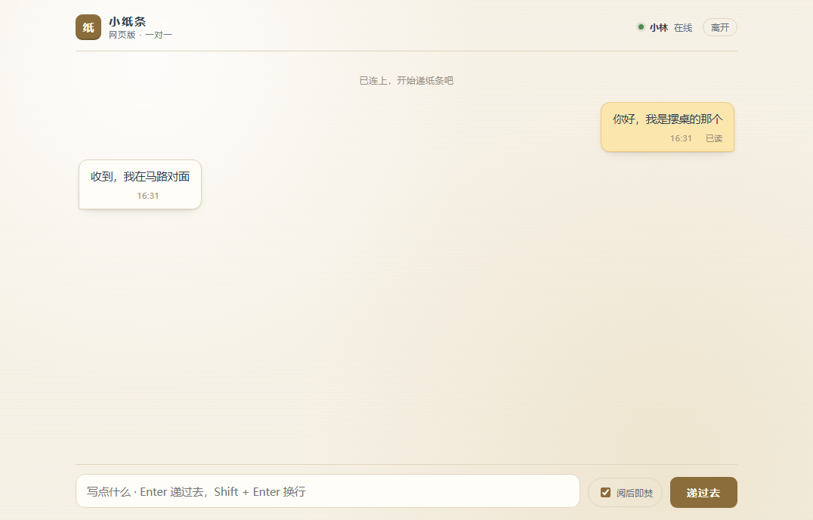

# 小纸条 · 网页版

> 同一张桌子上说话。两个人各输一个 4 位房间号，就能在浏览器里互相递纸条——
> 不用装软件，不用连同一个 WiFi，消息在两台设备之间**直连**，不经过任何服务器。

**在线地址：<https://yilongxiaoyi.github.io/zhitiao/>**



## 怎么用

1. 一个点「摆一张桌子」，拿到 4 位房间号
2. 把号码发给对方（微信、口头都行）
3. 对方输号码点「入座」

连上就能打字：Enter 发送，Shift + Enter 换行，勾「阅后即焚」则对方看到 10 秒后两端同时销毁。

## 它是怎么工作的

```
   你的浏览器  ──── WebRTC 数据通道（加密，点对点）────  对方的浏览器
        │                                                  │
        └───── 信令：只用来交换连接信息，不传消息内容 ─────┘
                    （PeerJS 公共服务器）
```

- **消息不走服务器**：建立连接后，内容在两个浏览器之间直接传输（WebRTC DTLS 加密）
- **信令**用 PeerJS 的公共服务器扯线，房间号就是它的 peer id
- **STUN** 换成了国内可用的（`stun.miwifi.com` / `stun.chat.bilibili.com`），
  因为 PeerJS 默认的 Google STUN 在国内不可达，会一直连不上
- **无后端、无数据库、无账号**：刷新页面即清空

## 本地跑

```
node tools/serve.js
# 打开 http://127.0.0.1:8080/
```

## 测试

```
node tools/test-core.js                                    # 消息状态机，32 项
node tools/e2e.js                                          # 本地端到端，19 项
node tools/e2e.js https://yilongxiaoyi.github.io/zhitiao/  # 打线上，19 项
```

`e2e.js` 会启动一个无头 Edge、开两个标签页、一个摆桌一个入座，真的互发消息并
检查「已送达 / 已读 / 阅后即焚」，最后把截图存到 `tools/shots/`。

> 无头浏览器默认会把本地 IP 换成 `.local` 主机名（mDNS 混淆），导致 P2P 一直卡在连接中。
> 脚本里已经加了 `--disable-features=WebRtcHideLocalIpsWithMdns` 绕开。

## 限制

- **1v1**：一个房间号只接一个人
- **要联网**：不是局域网方案（那个见另一个目录）
- **个别网络连不上**：严格 NAT 或禁 UDP 的企业网/校园网，打洞会失败，换手机流量通常就好
- **信令是公共服务**：PeerJS 的免费服务器不保证稳定，长期用建议自建

## 部署

见 [部署说明.md](部署说明.md)。当前主页由 GitHub Pages 从 `main` 分支自动发布。
